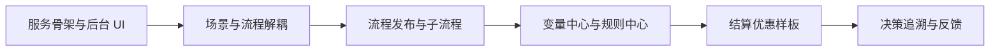
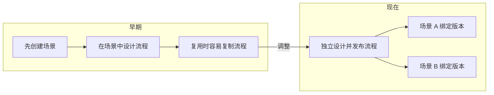
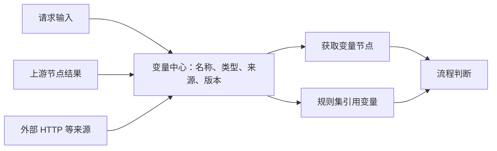
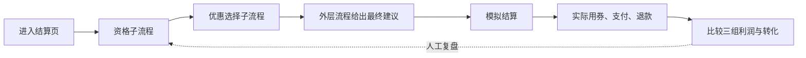
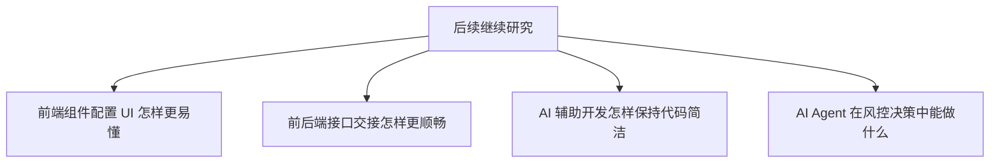
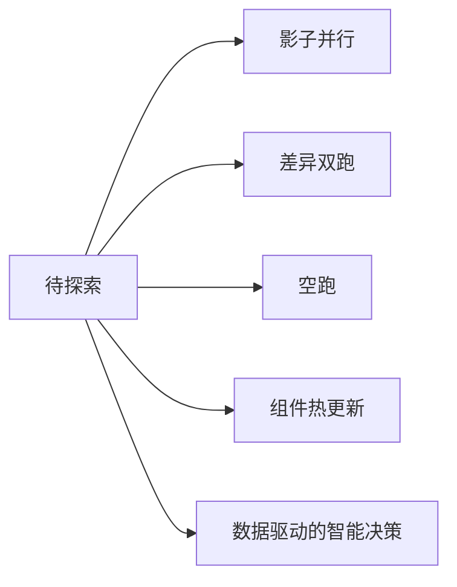
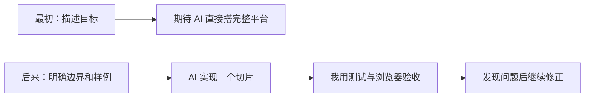

# 学习与开发记录

> 慢慢来，比较快。先想清业务场景和模块，再逐步细化代码。

这里记录开发过程中的问题、调整和想法；逐日进展见[七天时间线](day-by-day/README.md)。

## 从骨架走到业务闭环

原笔记的 Day 1、Day 2、Day 3 是思考阶段，不严格对应某个自然日。

## 问题 1：流程为什么要从场景里拆出来

场景负责选择入口；流程成为可复用资产。发布新版本后，已有场景仍使用原来绑定的版本，需显式切换。

## 问题 2：取数能力放在哪里

最初担心 RPC、数据库等调用直接散落在组件配置里。现在由变量中心管理业务数据的取值契约，流程和规则引用固定版本；现有外部取值能力有明确边界，并非任意 RPC、数据库都已接入。

## 用营销样板检查设计

建议用券、实际用券和最终利润分别记录。固定样本用于检查链路与指标计算，不代表真实营销效果。

## 还没解决好的问题

前后端已有接口文档和页面联调记录；原笔记里设想的“中间层”、更好的前端 AI 能力与协作方式仍待探索。AI 写代码时，也要避免冗余实现，自己需要能解释代码。

## 以后可探索的能力

这些是想法，不是当前 PRD 承诺或已实现功能。下一步仍应先明确业务目标、数据来源和验收指标。

参考：[v0.1 决策子流程 PRD](../prd/iterations/2026-10-v0.1-decision-subflow/prd.md) · [结算优惠场景](../prd/scenarios/checkout-offer-incremental-profit.md) · [流程发布代码](../src/main/java/com/dmp/riskdecision/policy/service/impl/FlowAssetServiceImpl.java) · [决策执行代码](../src/main/java/com/dmp/riskdecision/decision/service/impl/DecisionExecutionServiceImpl.java)

延伸阅读：[风控资料汇总](https://github.com/yangliang1415/awesome-risk-control) · [美团风控系统经验](https://tech.meituan.com/2017/01/13/risk-control-system-experience-sharing.html)

## 第 1 天与第 7 天的认知变化

第 1 天我更期待 AI 能快速搭好后端骨架、后台 UI 和流程，把一个想法直接变成平台。到第 7 天回看，我觉得它更适合**在边界明确后，快速完成一个可验证的切片**：例如按已确定的场景、版本和结果契约改前后端，再用测试和真实浏览器核对。

我的用法也变了：先说明业务问题和“不新增优惠”这类结果的含义，再让 AI 做设计与实现；完成后亲自检查页面、接口、版本和数据口径。第 6、7 天生病，没有新增开发进展；这里是对前五天工作的回顾，不是第 7 天的新实验。

## 两件“原来还能这样”的事

以下“给 AI 的任务”是根据开发记录回顾的任务描述，**不是保存下来的原始 prompt**。

| 当时的任务 | 我的操作 | 为什么意外 |
| --- | --- | --- |
| 让同一条流程被多个场景复用。 | 提出“场景和流程耦合”的问题，推动独立流程资产与版本绑定；再用两个场景绑定 v1、只切换其中一个到 v2，在浏览器和真实接口核对。 | AI 辅助改动不只是补一个页面，还把数据关系、版本行为和前端操作一起串起来；另一个场景仍稳定运行 v1。[联调证据](references/local-h2-flow-ui-integration-2026-10-13.md) |
| 把“推荐优惠”做成能复盘的业务样板。 | 明确三组实验、资格判断、实际用券和利润口径；让 AI 接通子流程、结果节点、反馈和报告，再用固定 30 人样本及退款用例核对。 | 一条抽象流程能落到“低额券人均利润 7.50 元、高额券 4.80 元”这样的可解释结果；也看出转化率最高不等于利润最高。[联调证据](references/local-h2-marketing-demo-2026-10-14.md) |

## 一件“这玩意还不行”的事

**任务：**做结算优惠营销页面。AI 辅助实现后，测试和构建通过，但首次打开真实浏览器时，控制台出现 **3 条 Ant Design 废弃属性警告**。原始 prompt 和警告全文没有留存，不能把下面的概括冒充原文。

**怎么发现、怎么处理：**我通过浏览器联调发现警告，随后把页面属性改为当前的 `orientation`、`title` 和单独文字标签；重载后没有新的错误。[当时的联调记录](references/local-h2-marketing-demo-2026-10-14.md)

这件事提醒我：AI 能较快写出可运行页面，**但编译和单元测试不能代替真实页面检查**。前端组件配置是否好懂，也仍需要人看着页面继续打磨。

## 再给一周，我会怎么改进

| 时间 | 我会做什么 | 验收方式 |
| --- | --- | --- |
| 第 1—2 天 | 先选一个最小业务问题，写清输入、最终结论、失败含义和版本关系；再让 AI 分步实现。 | 能用一个样例说清“为什么得出这个结果”。 |
| 第 3—4 天 | 按接口文档逐页核对前后端，重点检查组件配置表单、错误提示和真实浏览器控制台。 | 页面操作顺畅，接口字段一致，控制台无新增错误。 |
| 第 5—6 天 | 用固定样本、失败输入和版本切换做回归；删掉不服务当前场景的冗余代码。 | 三组指标、失败路径和旧版本行为都可重复验证。 |
| 第 7 天 | 复盘 AI 哪些地方帮忙快、哪些地方需要我补充约束，更新开发记录。 | 留下可复用的任务说明、验收步骤和未解决问题。 |
