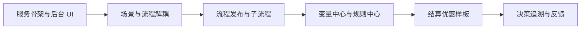
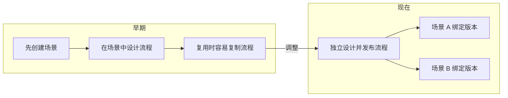
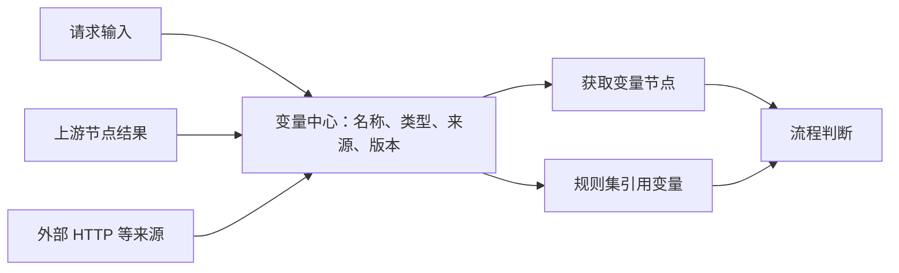
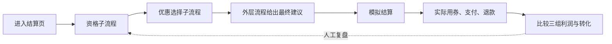
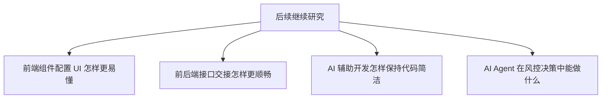
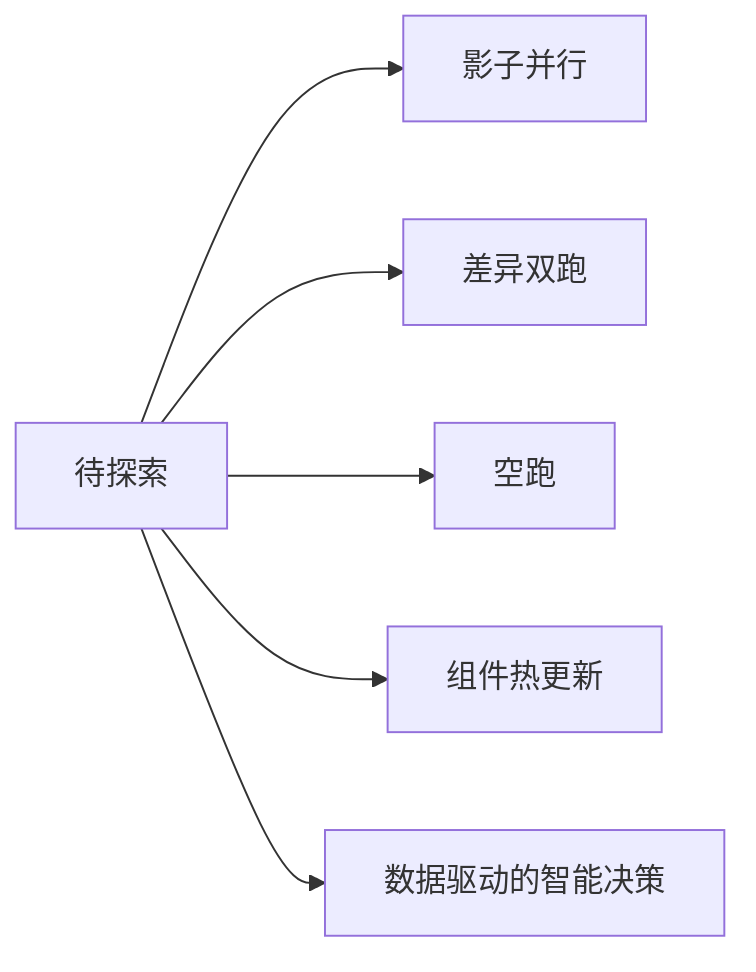

# 学习与开发记录

> 慢慢来，比较快。先想清业务场景和模块，再逐步细化代码。

这里记录开发过程中的问题、调整和想法；逐日进展见[七天时间线](day-by-day/README.md)。

## 从骨架走到业务闭环

原笔记的 Day 1、Day 2、Day 3 是思考阶段，不严格对应某个自然日。

## 问题 1：流程为什么要从场景里拆出来

场景负责选择入口；流程成为可复用资产。发布新版本后，已有场景仍使用原来绑定的版本，需显式切换。

## 问题 2：取数能力放在哪里

最初担心 RPC、数据库等调用直接散落在组件配置里。现在由变量中心管理业务数据的取值契约，流程和规则引用固定版本；现有外部取值能力有明确边界，并非任意 RPC、数据库都已接入。

## 用营销样板检查设计

建议用券、实际用券和最终利润分别记录。固定样本用于检查链路与指标计算，不代表真实营销效果。

## 还没解决好的问题

前后端已有接口文档和页面联调记录；原笔记里设想的“中间层”、更好的前端 AI 能力与协作方式仍待探索。AI 写代码时，也要避免冗余实现，自己需要能解释代码。

## 以后可探索的能力

这些是想法，不是当前 PRD 承诺或已实现功能。下一步仍应先明确业务目标、数据来源和验收指标。

参考：[v0.1 决策子流程 PRD](../prd/iterations/2026-10-v0.1-decision-subflow/prd.md) · [结算优惠场景](../prd/scenarios/checkout-offer-incremental-profit.md) · [流程发布代码](../src/main/java/com/dmp/riskdecision/policy/service/impl/FlowAssetServiceImpl.java) · [决策执行代码](../src/main/java/com/dmp/riskdecision/decision/service/impl/DecisionExecutionServiceImpl.java)

延伸阅读：[风控资料汇总](https://github.com/yangliang1415/awesome-risk-control) · [美团风控系统经验](https://tech.meituan.com/2017/01/13/risk-control-system-experience-sharing.html)
