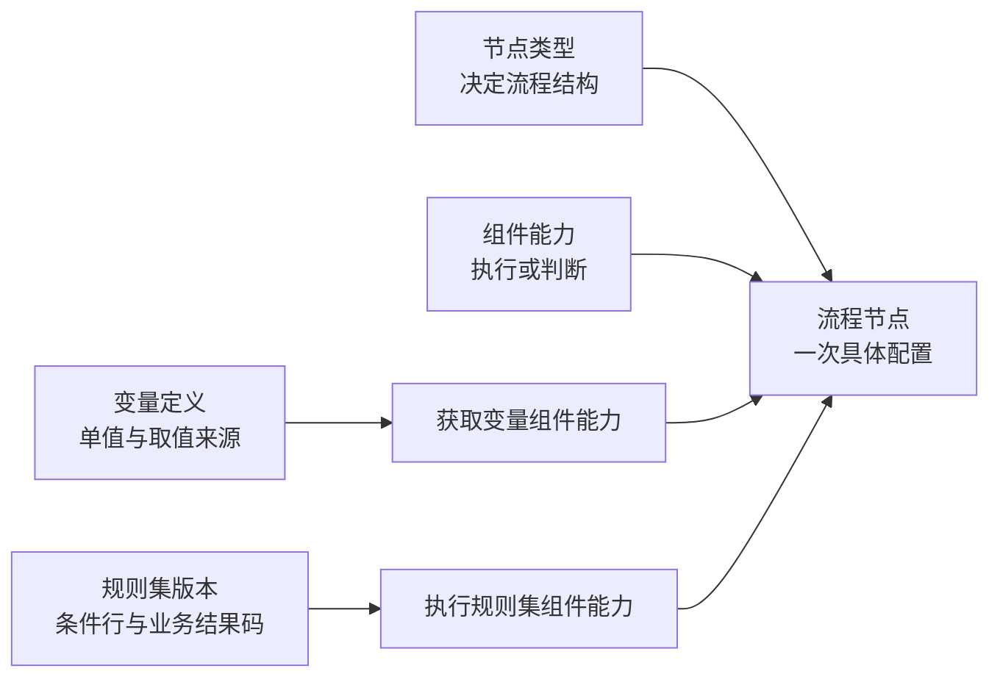

# 节点、组件与变量中心的管理边界

状态：已确认的职责边界；只读“组件管理”目录和二级分类已实现，启停与编辑能力仍待讨论。

## 1. 三层关系

画布上的**节点类型**回答“这一步怎样参与流程”；**组件能力**回答“这一步做什么”；**变量定义**回答“取得哪个业务数据”；**规则集版本**回答“这一套判断使用哪些条件和结果码”。一个组件能力可以被多条流程、多处节点引用；变量和规则集也都可以被多个流程节点固定版本引用。

当前代码的图节点外壳是 `id`、`kind`、`componentKey`、`failurePolicy`、`config`。其中 `kind` 是节点类型，`componentKey` 只在普通组件和条件节点上选择注册能力。变量中心的版本由“获取变量”节点配置引用。

## 2. 现有节点类型及归属

| 画布节点类型 | 当前职责 | 是否选择组件能力 | 建议管理归属 |
| --- | --- | --- | --- |
| `START` 开始 | 流程入口 | 否 | 平台内置结构；画布配置 |
| `END` 结束 | 流程出口 | 否 | 平台内置结构；画布配置 |
| `PARALLEL_SPLIT` 并行拆分 | 启动并行分支 | 否 | 平台内置结构；画布配置 |
| `PARALLEL_JOIN` 并行汇合 | 等待并行分支 | 否 | 平台内置结构；画布配置 |
| `CONDITION_JOIN` 条件汇合 | 合并互斥分支 | 否 | 平台内置结构；画布配置 |
| `RESULT` 业务结果 | 写最终结论、原因和建议 | 否；有平台内置执行适配 | 平台内置结果节点；流程内配置 |
| `SUBFLOW` 决策子流程 | 调用固定版本的其他流程 | 否；有平台内置执行适配 | 流程资产管理版本；调用关系在画布配置 |
| `COMPONENT` 普通组件 | 执行一次能力并保存节点结果 | 是 | 能力目录由平台维护；具体调用在画布配置 |
| `CONDITION` 条件 | 根据能力结果选择 true/false | 是 | 能力目录由平台维护；判断参数在画布配置 |

这里的“建议管理归属”仍是后续扩展的产品边界；当前“组件管理”只读展示已接入能力。`RESULT` 和 `SUBFLOW` 虽有 LiteFlow 执行适配器，仍是平台节点，不应因为实现类叫 Component 就变成后台可登记的业务组件。

## 3. 现有可选组件能力

| 组件能力 | 可用节点类型 | 作用与输出 | 当前定义放在哪里 | 第一版后台建议 |
| --- | --- | --- | --- | --- |
| `emit-value` 输出固定值 | `COMPONENT` | 将配置值写入节点结果；演示用途 | 代码注册 | 组件目录可见，标为示例；不提供业务登记 |
| `get-variable` 获取变量 | `COMPONENT` | 引用变量版本，输出一个强类型值 | 能力在代码；变量在变量中心 | 组件目录说明能力；变量定义仍在变量中心维护 |
| `is-positive` 输入为真 | `CONDITION` | 读取流程输入，返回 true/false | 代码注册 | 组件目录可见，标明输入规则 |
| `equals-value` 上游结果相等 | `CONDITION` | 读取上游结果字段，返回 true/false | 代码注册 | 组件目录可见，标明来源与比较规则 |
| `compare-value` 比较变量 | `CONDITION` | 对强类型单值做相等或数值大小比较，返回 true/false | 代码注册 | 组件目录可见，标明类型与操作符 |

当前 `/api/components` 返回上述组件及“执行规则集”“规则结果等于指定码”的展示名称、分类、适用节点类型、配置字段和默认配置；注册表仍由代码维护。它目前是**组件能力目录**，不是可在后台创建全新执行器的管理能力。二级分类为取值组件 `DATA`、判断组件 `CONDITION`、规则组件 `RULE`；`RULE` 同时包含普通执行节点和结果判断节点，因此分类不能用画布节点类型代替。

## 4. 如果新增“组件管理”菜单

第一版已做成**只读能力目录**：二级菜单按取值、判断、规则能力筛选，展示用途、输出、配置字段、适用节点类型和初始配置。当前没有启停、编辑、登记或跳转到引用该能力的流程。新增一种执行能力仍需后端实现与注册，后台不允许输入任意 Java 类名、URL 或 SQL 来制造新能力。

可复用的**业务定义**交给对应中心管理：变量由变量中心管理；规则集及其版本由规则中心管理；流程及其版本由流程资产管理。未来出现发券、通知等带副作用的能力时，再明确是否需要独立的动作定义与组件管理版本，先确定幂等、权限和失败补偿，避免把它们混成“取变量”。

## 5. 用两个场景检验边界

1. **查询用户权益**：在变量中心定义 `userBenefitAmount` 及来源、类型和版本；画布放“获取变量”节点，选版本并映射 `userId`；条件节点比较金额。组件管理展示“获取变量”和“比较变量”的契约，不重复维护权益 RPC 地址。
2. **发放优惠券**：这是有副作用的动作，不能登记成变量。若未来画布要执行发券，应有独立能力契约，明确请求幂等键、失败和补偿，再决定它是否进入组件管理的可配置定义范围。

## 6. 下一轮要决定的事

- 将来是否允许管理员启用、停用已由代码接入的能力？若允许，如何保护已发布流程？
- 是否需要在目录中展示平台内置结构节点作为说明，但明确标为不可管理？
- 组件能力的输出契约要精确到什么程度，才能支持流程校验和后台自动生成配置表单？

当前实现依据：[节点类型](../../src/main/java/com/dmp/riskdecision/orchestrator/graph/NodeKind.java)、[组件注册表](../../src/main/java/com/dmp/riskdecision/component/liteflow/registry/ComponentRegistry.java)、[变量中心接口](../api/variable-center.md)。
