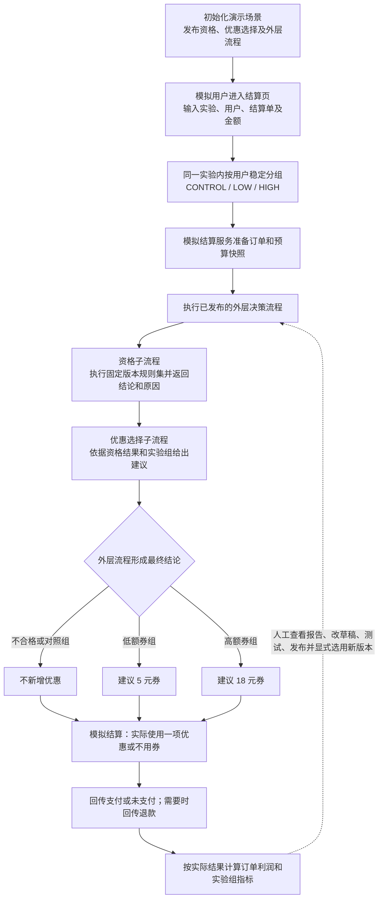
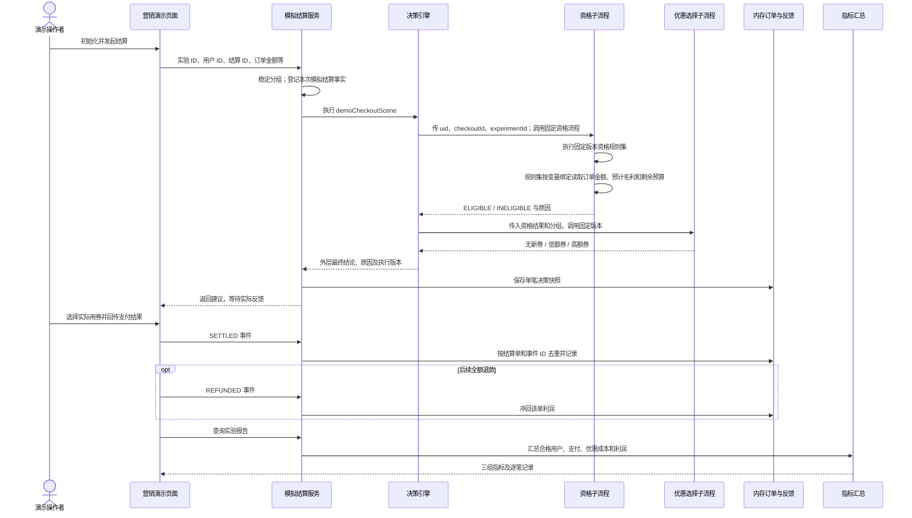

# 结算优惠营销闭环演示说明

状态：可运行样板说明，资格规则已迁入规则中心。后续可直接修订本文；[业务场景基线](../prd/scenarios/checkout-offer-incremental-profit.md)记录跨迭代目标，[接口文档](api/marketing-demo.md)记录当前请求与响应字段。

## 1. 这个演示要说明什么

用户进入结算页时，决策平台建议本次是否新增优惠，以及使用低额券还是高额券。模拟结算随后回传**实际**用券、支付和退款。实验报告按对照组、低额券组、高额券组比较支付转化率和人均贡献利润，再由人判断下一版策略如何调整。

完整闭环是“**发布决策 → 结算决策 → 实际反馈 → 利润汇总 → 人工调整并重新发布**”。营销工作台把这五步放在同一实验上下文中，展示实际运行的规则与流程版本，并引导到规则中心及流程画布编辑下一版；报告不会自动修改规则或发布版本。样板不连接真实商城，不实际发券，也不代表真实营销收益。

## 2. 业务流程图

“不新增优惠”是正常业务结果，原有优惠仍可使用；流程运行失败是单独的执行状态。建议用券只是一条决策结果，不能视为已经发券或已经使用。

## 3. 系统调用时序

初始化通过现有流程资产和场景服务完成。外层流程发布时固定引用两条子流程的**具体版本 ID**；子流程后来发布新版本，不会自动改变已发布的外层流程。场景继续执行已选中的外层版本，直到工作台显式“选用当前外层版本”；普通结算和固定样本不会隐式切换。逐笔记录保留本次外层、子流程和资格规则版本及命中行，便于回看某笔建议从哪里来。

## 4. 当前样板规则与数据口径

以下数字是**固定演示配置**，不是平台通用规则：

| 项目 | 当前实现 |
| --- | --- |
| 分组 | 用 `experimentId:userId` 的稳定哈希分入 `CONTROL`、`LOW`、`HIGH`；同一用户在同一实验内不跨组。 |
| 资格 | 订单金额不少于 100 元；优惠前贡献毛利减去 18 元后不少于 10 元；本实验已实际使用且未退款的优惠金额加 18 元不超过 2,000 元。三组条件相同。 |
| 建议 | 不合格或对照组不新增优惠；低额组建议满 100 减 5 元；高额组建议满 100 减 18 元。 |
| 实际优惠 | 支付时可不用券、使用本次建议券，或使用已有优惠；新增券与已有优惠互斥。实际金额由反馈决定。 |
| 订单利润 | 已支付且未退款：优惠前贡献毛利 − 实际商家优惠额；未支付或全额退款：0。 |
| 主指标 | 组内合格且进入结算页的**唯一用户**的人均贡献利润；未支付用户计入分母、利润计 0。同一用户多笔合格订单先汇总利润。 |
| 支付转化率 | 组内未退款的已支付唯一用户数 ÷ 合格唯一用户数；页面展示为百分数。 |

当前金额门槛、利润底线和预算门槛由**规则中心已发布的 `demoOfferEligibilityRules` 版本**执行。模拟结算页面输入金额和毛利后，业务服务只按 `uid + checkoutId + experimentId` 登记进程内事实；决策请求不携带这三个规则值。资格规则集的三个输入分别绑定变量中心的 `demoOrderAmount`、`demoMarginAfterMaxOffer`、`demoRemainingBudget` 固定版本，执行规则时按三个定位标识取值。资格流程图只保留“执行规则集、判断结果、业务结论”等节点。其中最高券额 18 元、预算总额 2,000 元和预算累计仍属于样板模拟来源的固定计算。资格子流程固定规则版本，并从命中行复制原因；优惠选择子流程使用资格结果和分组；外层流程自己的 `RESULT` 节点给出最终业务结论。变量更新后须在规则中心重新选择变量版本并发布规则，再依次发布资格与外层流程，最后在工作台选用当前外层版本；原已发布版本继续按固定引用运行。

工作台先展示当前实验的人均贡献利润结论和三组指标，再引导体验单笔决策、实际反馈及逐笔追溯。“查看决策链”按模拟结算输入、资格规则、优惠选择、外层结论展示本次记录，并把实际支付、用券和利润放在“决策之后”；每一步可展开请求字段、规则原因码和固定版本。它依据营销订单快照组织业务阅读路径；“查看平台原始执行记录”可通过独立 `executionId` 跳到通用决策记录，核对真实节点轨迹、子流程输出和请求 JSON。版本卡分别显示**资产当前发布版本**与**场景实际运行版本**；未初始化时版本卡提前显示初始化入口。规则集、资格或选择子流程、外层流程发布新版后，版本卡给出下一步编辑入口；外层发布完仍需点击“选用当前外层版本”才能切换新决策。页面首次加载只读状态和报告，不会自动初始化资产。

预算口径还有一个需要核对的差异：当前实现累计的是所有已支付、未退款订单的**实际优惠额**，包括原有优惠；业务场景基线称它为“活动新增券预算”。固定 30 人样本没有原有优惠，因此不影响上表结果。接入真实业务前需要明确原有优惠是否占用活动预算。

结算记录以 `experimentId + checkoutId` 唯一定位；相同输入重试返回原决策，不同输入报冲突。反馈按 `experimentId + checkoutId + eventId` 去重：相同事件重放不重复计数，同一事件 ID 的不同内容报冲突。退款修正利润和有效支付/优惠成本，但保留原用户及结算记录。

## 5. 固定 30 人样本如何得到结果

点击“运行 30 人固定样本”后，系统为三组各选 10 位稳定分组用户，逐人调用真实决策流程，再产生模拟支付反馈。每笔订单金额 120 元、优惠前贡献毛利 30 元、已有优惠 0 元。三组的付款人数是样板预设行为，不是决策引擎预测出来的。

| 组别 | 合格用户 | 模拟付款 | 实际优惠 | 支付转化率 | 组内总利润 | 人均贡献利润 |
| --- | ---: | ---: | ---: | ---: | ---: | ---: |
| 对照组 | 10 | 2 | 每笔 0 元 | 20% | 2 × 30 = 60 元 | 6.00 元 |
| 低额券组 | 10 | 3 | 每笔 5 元 | 30% | 3 × (30 − 5) = 75 元 | 7.50 元 |
| 高额券组 | 10 | 4 | 每笔 18 元 | 40% | 4 × (30 − 18) = 48 元 | 4.80 元 |

因此样板展示的是：高额券组转化率最高，但低额券组的人均贡献利润最高。工作台还显示低额券组相对对照组 **+1.50 元/人**、高额券组 **−1.20 元/人**；没有对照或实验组合格用户时显示“样本不足”。退款率按发生过退款的唯一用户数除以曾支付的唯一用户数计算，推荐券实际使用率按至少有一笔未退款订单用过推荐券的唯一用户数除以获得过新增券推荐的唯一用户数计算；分母为零时为空。同一个实验 ID 重复运行固定样本不会再生成这 30 笔订单；若手动向同一实验添加订单，报告会包含那些订单，数字就不再等于上表。

## 6. 建议如何在页面演示

从前端首页进入“营销闭环演示”工作台：

1. 未初始化时先在版本卡点击“初始化样板”。提交新实验 ID（如 `demoFixture1`），在“看实验结果”运行 30 人固定样本，核对三组利润、两个相对对照组差值和 30 条逐笔记录；再查看页面下方实际运行的版本链。
2. 切换到另一个实验 ID（如 `demoManual1`）；工作台会清空上一实验的报告。输入结算 ID `order001`、用户 ID `user001`、订单金额 `120`、优惠前毛利 `30`、已有优惠 `3`，点击“执行单笔决策”。观察分组、结论、原因、规则命中和版本。
3. 在该笔记录的反馈区选择“已支付”和“使用已有优惠”，回传结算。该笔利润应为 `30 − 3 = 27.00` 元；即使流程推荐新券，推荐金额也不计作实际成本。
4. 点击“回传全额退款”，使用新的事件 ID（如 `refund001`）。该笔利润应变为 `0.00` 元。
5. 在规则中心发布资格规则新版，返回工作台刷新策略状态；依次在资格、外层流程画布选版并发布，最后点击“选用当前外层版本”。切换前的旧结算仍保留原版本记录。

订单和反馈仅在当前后端进程的内存中；重启后清空。流程资产、发布版本及场景绑定存于数据库。固定样本用于核对链路与计算口径，不能据此判断真实用户的因果效果。

## 7. 后续修订时优先确认

下面是**待讨论项**，不是当前实现承诺：

- 样板最高券额和预算总额是否也迁入有版本的配置或计算组件；当前可在规则中心调整比较门槛。
- 真实结算系统如何裁决已有优惠与新增券，以及商家实际承担金额从哪里取得。
- 实验观察窗口、最小样本量、退款观察期和跨多笔订单的支付转化口径。
- 策略复盘后如何测试、审批及切换新外层版本；是否需要自动化建议。
- 真实订单与反馈持久化、跨实例幂等、鉴权及故障补偿。

当前接口字段与错误处理见[营销演示 API](api/marketing-demo.md)，实际本地联调结果见[联调记录](references/local-h2-marketing-demo-2026-10-14.md)。
