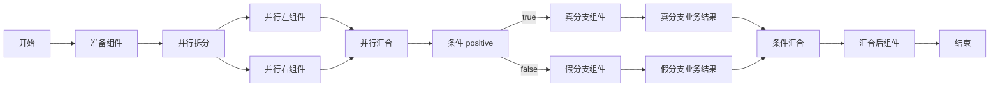

# 全节点 `test` 流程说明

日期：2026-10-13，2026-10-14 补充显式业务结果节点。示例图源文件为 [`web/src/flow/all-node-example.json`](../../web/src/flow/all-node-example.json)，前端画布的“载入全节点示例”使用同一份图。

## 图与节点职责

这张图有 14 个节点、15 条连线，覆盖当前全部八种节点类型。`emit-value` 组件分别写入“准备数据”“并行左侧”“并行右侧”“条件为真／假”和“汇合后处理”；条件组件 `is-positive` 读取输入 `positive`。

当前的**并行汇合**只等待两个分支完成，**条件汇合**只把被选中的分支接回主路径。条件真分支的 `RESULT` 给出 `LOW_VALUE_OFFER`，假分支给出 `NO_NEW_OFFER`；一次运行只会选中其中一个。`finalize` 仍是汇合后执行的演示组件。结果只说明静态节点与条件路径的执行，不代表优惠资格或选择子流程已经实现。

## 页面操作

隔离 H2 环境运行期间可直接打开：

- 流程图：`http://localhost:8001/flows/test/editor`
- 触发页：`http://localhost:8001/scenes/testScene/flow`

2026-10-13 的隔离 H2 联调曾创建旧版 `test` v1；该进程的内存数据不持久。用当前模板重建后，在场景画布上将“输入 positive”切换为 `true` 或 `false`，点击“执行示例”。两种输入都会执行 `prepare`、`parallelLeft`、`parallelRight`、`finalize`；`true` 执行 `truePath`、`trueResult` 并返回 `LOW_VALUE_OFFER`，`false` 执行 `falsePath`、`falseResult` 并返回 `NO_NEW_OFFER`。当前后端集成测试验证两条路径均为 `SUCCEEDED`。

流程较宽时可用“放大”“缩小”“适应画布”，并拖动画布查看节点。点击节点，右侧会显示该节点类型的作用。

H2 数据在后端进程退出后消失。需要重建时：在“流程资产”创建流程码为 `test` 的流程，打开画布并选择“载入全节点示例”，保存、校验、发布；再创建 `testScene` 场景并将它绑定到 `test`。后端集成测试 `AllNodeDemoFlowTest` 会从同一份 JSON 读取图并校验两条路径。
