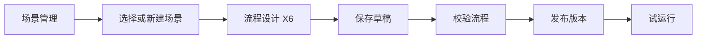

# 风控决策后台首版设计

日期：2026-10-13  
状态：已确认并进入实施；验收以代码和测试结果为准。

## 目标

把现有单页 X6 示例扩展为风控决策后台。用户先管理场景，再进入该场景的流程设计页，完成草稿保存、校验、发布与试运行。画布是后台中的一个业务页面，场景码始终明确。

首版采用 Ant Design Pro v6 作为后台基座，使用其 React 19、Ant Design 6、Umi Max 4 路由和布局能力。现有 X6 编辑器作为页面迁入，沿用项目定义的 `GraphDefinition` 和 `ApiResponse<T>` 接口契约。技术选型依据见 [Ant Design Pro 官方仓库](https://github.com/ant-design/ant-design-pro)及其 [v6 发布说明](https://github.com/ant-design/ant-design-pro/releases)。

## 首版边界

| 包含 | 暂不包含 |
| --- | --- |
| 后台侧栏、顶栏、面包屑及路由 | 真实登录、单点登录、权限校验 |
| 场景列表、新建和编辑基本信息 | 版本列表、回滚、执行记录页面 |
| 场景下的流程设计、草稿、校验、发布、试运行 | 规则、名单、模型等真实业务组件管理 |
| 静态菜单和模拟当前用户 | 基于权限的动态菜单 |

模拟用户只用于前端展示；场景、草稿和版本仍调用真实后端接口，不使用模拟业务数据。菜单只展示已实现页面。

## 页面与导航

| 路由 | 菜单 | 页面职责 |
| --- | --- | --- |
| `/` | 无 | 跳转到 `/scenes` |
| `/scenes` | 场景管理 | 列表、搜索、新建、编辑场景，以及“设计流程”入口 |
| `/flow-design` | 流程设计 | 先选择场景，复用场景列表能力进入对应画布 |
| `/scenes/:sceneCode/flow` | 不单独显示 | 当前场景的 X6 流程设计页面 |

场景列表显示场景码、名称、描述、当前已发布版本和更新时间。列表和流程设计入口通过同一场景数据服务读取数据；不会维护两份场景状态。进入画布后显示场景名称和场景码，面包屑可返回场景列表。直接访问画布 URL 时从场景码加载场景；不存在的场景展示明确的错误页面。

## 场景数据与接口

`tb_scene` 在现有 `scene_code`、`published_version_id` 和公共字段基础上增加：

- `scene_name`：必填，最多 128 字符；新建时输入，允许修改。
- `description`：可选，最多 512 字符；允许修改。

场景码沿用现有 64 字符机器标识规则，创建后不可修改。已存在的场景数据在新增字段的迁移中以场景码回填名称，避免历史数据因非空字段而无法升级。新建场景时立即创建场景记录，`published_version_id` 为空，草稿在首次保存画布时创建。首版不提供场景删除和停用操作；`isactive` 保留既定逻辑删除语义。

新增接口均沿用 `ApiResponse<T>`：

| 方法与路径 | 请求与返回 |
| --- | --- |
| `GET /api/scenes?keyword=&page=1&pageSize=20` | 按场景码或名称搜索，返回分页记录与总数 |
| `POST /api/scenes` | 提交 `sceneCode`、`sceneName`、`description`，返回新建场景 |
| `GET /api/scenes/{sceneCode}` | 返回场景详情及当前已发布版本号 |
| `PUT /api/scenes/{sceneCode}` | 仅更新名称和描述，场景码不出现在可修改字段中 |

场景码冲突返回明确错误码。现有草稿、校验和发布接口继续使用 `/api/scenes/{sceneCode}/...`；场景管理落地后，这些操作只接受已创建且有效的场景，不再在发布时隐式创建场景。场景码、名称由服务端校验。数据结构变更在已确认的 Flyway 迁移之后以新增版本脚本完成，不回写历史迁移。

## 流程设计页

新场景没有草稿时，画布默认放置 `START` 与 `END` 两个节点，不自动保存、不自动连线。`emit-value` 演示流程作为显式选择的示例模板；选择模板也只改变当前画布，用户保存后才形成草稿。已有草稿则从后端加载，不用默认模板覆盖。

画布保留现有节点配置、连线、分支标签、校验问题定位和试运行能力。发布按钮仅在“当前画布已保存，且同一内容已通过校验”时可用；后端发布仍独立校验草稿修订号和图结构。切换场景、离开页面或加载其他草稿时，若画布有未保存修改，应提示用户。

画布在后台布局的内容区域内自适应；侧栏收起或窗口大小变化后，节点与连线仍可完整查看、拖动和连接。编辑器样式限定在页面作用域，避免覆盖后台框架的按钮、表单等全局样式。

## 前端与后端边界

- 前端基座由现有 Vite 单页入口迁到 Ant Design Pro v6 / Umi Max；不同时维护两套路由和布局。现有 X6 图转换、API 调用和相关测试随编辑器迁入。
- 前端统一解包 `ApiResponse<T>`。场景列表、详情与画布接口共享请求封装；图校验问题继续定位到节点或连线。
- 后端沿用 `policy` 领域内 Controller、Service、Mapper、VO 的分层；场景基本信息由独立业务用例负责，流程发布用例仍专注草稿和版本。
- 首版模拟用户与静态菜单留在前端，不把模拟身份当作后端鉴权依据。

## 验收标准

1. 后台打开后进入场景列表；侧栏可进入场景管理和流程设计入口。
2. 可新建场景、搜索和编辑名称与描述；已创建场景的场景码不可编辑。
3. 新场景进入画布显示开始、结束节点；选择演示模板需明确操作；已有草稿能恢复。
4. 在后台页面中完成保存、校验、发布、试运行，行为与现有接口一致；发布后列表可显示当前版本。
5. 未保存内容离开页面时有提示；错误响应和节点问题能被用户理解和定位。
6. 前端构建、页面测试和后端相关测试通过；场景数据迁移验证既有记录可读取。

首版设计不以模拟登录或模拟权限为验收项。
