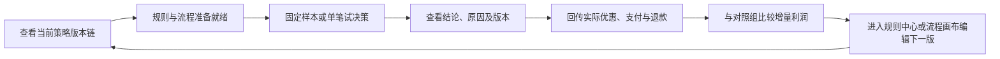

# 营销场景一站式工作台设计

日期：2026-10-15  
状态：已确认并实施的第一版设计；实际字段与错误语义以营销演示接口文档为准。

## 1. 目标与使用边界

以现有“结算优惠与增量利润”固定样板为入口，让使用者按**准备策略 → 试决策 → 回传实际结果 → 看效果 → 准备下一版**的顺序完成一次演示。工作台显示当前真正运行的版本链、每笔决策的原因和实际反馈，并明确提示有新规则或新子流程尚未应用到外层流程。

本轮是**营销样板专用页面**。规则仍在规则中心编辑和发布，流程仍在流程资产画布编辑和发布；工作台提供有上下文的入口及返回后的状态刷新。工作台不自动改写流程草稿，不自动发布或切换版本。订单、支付、退款继续使用当前进程内的模拟数据，页面明确标注这些数据的生命周期。

## 2. 使用路径

工作台以一个 `experimentId` 为当前上下文。切换实验 ID 后立即清空上一实验的报告和最近一次决策，再加载新实验报告；较早请求返回时也不能覆盖新实验的数据。首次进入页面只读取状态和报告，**不自动初始化或发布资产**。首次使用者点击“初始化样板”，然后进入试决策。

### 2.1 策略版本卡

显示规则集 `demoOfferEligibilityRules` 的当前发布版本、资格流程当前发布版本及其固定规则版本、优惠选择流程版本、外层流程当前发布版本及其固定的两个子流程版本，以及场景当前选中的外层版本。工作台还要从**场景当前选中的外层版本**追溯其固定的资格、选择和规则版本，形成真实运行链；不能只根据各资产最新版本推测运行链。资产名称链接到对应规则中心或流程资产编辑页，版本 ID 作为只读状态展示，不伪装成已有的历史版本详情页面。

工作台同时显示两个独立概念：

- **当前运行链**：场景选中的外层版本以及该版本固定的资格、选择和规则版本。它可以继续运行旧版本。
- **待应用更新**：某项资产有较新的发布版本，但其调用方仍固定旧版本。这不是运行错误；页面提示应在哪个编辑页重新选版并发布。

引导顺序为“发布规则集新版 → 资格流程选择新版规则并发布 → 外层流程选择新版资格流程并发布 → 在工作台选用当前外层版本”。每一步完成后刷新状态卡，下一步才显示为可操作。优惠选择流程若更新，也要求外层重新选版。最后一步复用现有场景绑定能力，只切换场景选用的外层版本，不替用户发布规则或流程。工作台不以“规则中心的最新版本”冒充本次决策实际使用的版本。

当前模拟结算每次调用 `setup()`，而 `setup()` 会把场景重新绑定到外层最新发布版本；这会让“待应用版本”在下一次结算时被隐式切换。本轮需把结算和固定样本调整为**仅在尚未初始化时**自动建立样板，已初始化后保持场景选中的版本，直到使用者显式点击“选用当前外层版本”。直接调用原 `POST /setup` 仍可显式初始化或更新绑定，保持演示 API 的用途。

### 2.2 试决策与实际反馈

保留“运行 30 人固定样本”和单笔模拟结算，但把操作区放在版本状态之后。单笔结果显式显示 `SUCCEEDED` 或 `FAILED`、业务结论、原因、推荐优惠、资格规则集版本和命中规则行，以及外层与两个子流程版本。失败决策使用错误状态展示，不预填正常结算反馈，也不出现“决策成功”的提示。

选择一笔成功且尚未结算的记录后，在同一工作台回传支付或未支付及实际使用优惠；已支付记录可回传全额退款。反馈表单按记录状态展示有效操作，已有优惠与新增优惠互斥；事件 ID 重放仍遵循既有后端幂等规则。逐笔列表可展开查看推荐、实际优惠、利润、原因及版本。重新打开页面时，仍能从当前进程报告中选择已有记录继续回传。

### 2.3 效果与下一版

报告按对照、低额、高额三组显示合格用户数、支付转化率、人均贡献利润和实际商家优惠成本。低额、高额组增加**相对对照组的人均贡献利润差值**；对照组或对应实验组尚无合格用户时差值为 `null`，页面显示“样本不足”，不能显示为 0。固定样本的差值应为低额组 `+1.50` 元/人、高额组 `-1.20` 元/人。

逐笔记录继续区分推荐券与实际用券；报告补充退款率和推荐券实际使用率，便于解释“推荐了，但没有用”。退款率定义为**发生过全额退款的唯一用户数 ÷ 曾支付的唯一用户数**；推荐券实际使用率定义为**至少有一笔未退款订单实际使用推荐券的唯一用户数 ÷ 至少获得一次新增券推荐的唯一用户数**。分母为零时返回 `null`。报告只描述当前模拟样本，仍不自动推荐新规则或声称真实增量收益。“准备下一版”区根据版本状态列出下一步动作，并链接至已有编辑页；编辑页可以新标签打开，工作台提供“刷新策略状态”。

## 3. 数据与接口

后端先行提供 `GET /api/demo/checkout-offer/status`，**只读**返回营销样板资产的状态。未初始化时返回 HTTP 200、`initialized=false` 和可空版本字段，供页面展示初始化入口；读取状态不得隐式调用 `setup()`。初始化接口继续使用现有 `POST /setup`。状态响应至少包含：

| 字段 | 含义 |
| --- | --- |
| `initialized` | 规则、三条流程和场景是否具备可运行版本 |
| `ruleCurrentVersionId` | 规则中心当前发布版本 |
| `eligibilityCurrentVersionId`、`eligibilityPinnedRuleVersionId` | 资格流程当前版本及其固定规则版本 |
| `selectionCurrentVersionId` | 优惠选择流程当前版本 |
| `outerCurrentVersionId`、`outerPinnedEligibilityVersionId`、`outerPinnedSelectionVersionId` | 外层当前版本及其两个固定子流程版本 |
| `sceneSelectedOuterVersionId`、`sceneSelectedOuterVersionNumber` | 场景当前选中的外层版本；与外层当前发布版本比较可发现待切换状态 |
| `runningEligibilityVersionId`、`runningSelectionVersionId`、`runningRuleVersionId` | 由场景选中版本逐级追溯出的本次运行链 |

状态接口还需返回外层当前发布版本号，避免用版本 ID 与版本号直接比较。若部分资产缺失，返回已有字段并标明不可运行，不把“未初始化”伪装成 HTTP 500。版本之间的“待应用更新”由工作台依上述字段计算；服务端从已发布的不可变图及场景选中指针读取固定引用，页面不从草稿推断运行版本。若查询期间恰好发生发布，下一次刷新可得到最新状态；单次状态查询不承诺跨多张表的原子快照。

为维持模块边界，`business.marketing` 经 `policy.service` 读取场景选中版本及指定流程版本；本轮补充所需的只读 Service 方法，不直接依赖 `policy.repository` 或 Mapper。

现有 `POST /checkout`、`POST /feedback`、`POST /run-fixture` 和 `GET /report` 的请求响应形状保持兼容；结算与固定样本在已初始化后的隐式场景重绑定行为按 2.1 节调整。`DemoCheckoutResp` 增加可空的 `ruleSetCode`、`ruleVersionId`、`matchedRuleId` 和 `ruleReasonCode`，从资格子流程业务结果明细取得；旧的内存记录若没有这些字段则返回 `null`。报告的分组字段增加相对对照组的人均利润差值、退款率及推荐券实际使用率；由后端用 `BigDecimal` 计算并说明分母，前端只格式化展示。新增接口和字段先写入 `docs/api/marketing-demo.md` 并与测试核对，再由前端接入。

## 4. 页面结构和状态

保留 `/marketing-demo` 路由和现有菜单。页面分为五个连续区块：

1. **当前实验与策略状态**：实验 ID、初始化入口、当前运行链、待应用更新及编辑链接。
2. **试决策**：固定样本与单笔结算；单笔完成后自动选择该记录。
3. **实际反馈**：针对所选记录显示结算或退款表单，清楚标记待回传、已支付、未支付、已退款。
4. **效果复盘**：三组指标、相对对照组差值、样本量及逐笔详情。
5. **准备下一版**：按规则 → 资格流程 → 外层流程 → 场景的依赖顺序提示待处理事项。

页面实现按职责拆为策略状态、决策与反馈、效果报告、逐笔详情等局部组件；API 调用仍集中在 `web/src/services/marketingDemo.ts`。独立编辑页保留原路由。加载、空实验、失败、版本待应用和反馈冲突分别有清晰状态，不能让失败与正常“不新增优惠”共用一种展示。

## 5. 验收

- 新页面初次访问只读取状态和报告，不创建规则、流程或场景；点击初始化后看到可运行版本链。
- 修改并发布资格规则后，工作台显示“规则新版待应用”，旧决策仍按原规则版本运行；完成资格、外层和场景版本切换后，状态恢复为已应用，新决策才用新版。
- 外层发布新版但未在工作台选用时，连续单笔结算和固定样本仍使用场景已选中的旧版；点击“选用当前外层版本”后新请求才使用新版。
- 固定 30 人样本仍为对照 `6.00`、低额 `7.50`、高额 `4.80` 元/人；增量差值分别是 `+1.50` 和 `-1.20`。空组或仅有一个组时显示“样本不足”。
- 单笔不合格决策能看到命中原因与规则版本；正常“不新增优惠”和运行失败明确区分。失败记录不能提交正常反馈。
- 推荐券、实际用券、支付、未支付及退款可以在同一实验上下文内追踪；切换实验 ID 不显示上一实验的报告。
- 工作台能从任意待应用状态打开正确的规则或流程编辑页，返回刷新后版本状态准确；不自动发布和覆盖用户草稿。

## 6. 本轮不改变的业务边界

仍只使用模拟结算与内存反馈；不接真实发券或支付接口。最高券额、预算总额和分组算法仍是样板配置；本轮只改善工作台使用路径与观察能力。预算累计包含已有优惠以及缺少待支付额度预占的问题单独安排业务口径设计，不在页面优化时暗中改变。实验窗口、真实效果归因和自动优化也留待后续迭代。
