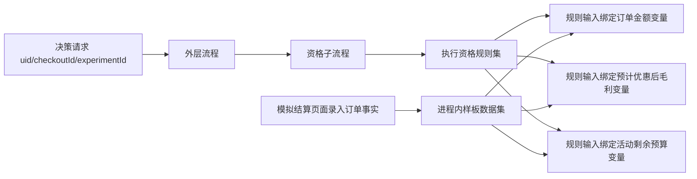

# 营销资格输入改由变量中心获取

日期：2026-10-15  
状态：已按会话确认的方向实施；此文固定本轮边界。

## 目标

结算请求的决策上下文只传 `uid`、`checkoutId`、`experimentId` 和演示实验组标识。订单金额、优惠后预计毛利、剩余预算在资格规则集的输入字段上绑定变量中心固定版本；执行规则集时取值。业务人员在规则中心更换变量版本，再按规则集、资格流程、外层流程的发布顺序固定引用。

现有演示页面仍允许输入订单金额、优惠前毛利和已有优惠，作为**模拟结算数据登记**，不再把这些金额直接塞进决策流程请求。同一用户可有多笔结算，因此 `uid` 之外保留 `checkoutId`；活动预算按 `experimentId` 隔离。只用 `uid` 无法唯一定位本次订单和活动。

## 数据路径

变量中心增加 `DEMO_MARKETING` 只读来源类型，由营销业务模块提供来源适配；变量中心保存它的不可变定义和参数契约。三项变量分别为 `demoOrderAmount`、`demoMarginAfterMaxOffer`、`demoRemainingBudget`，类型均为 `DECIMAL`。三项都按 `uid + checkoutId + experimentId` 定位同一次模拟结算事实；预算使用登记本次事实时从当前应用反馈汇总得到的快照。最高档券额 18 元和总预算 2,000 元仍是样板固定配置，由该模拟来源计算；本轮不引入通用公式编辑器。

变量中心保留 `HTTP_GET` 作为真实数据接入方式。`DEMO_MARKETING` 仅供样板可运行，后台可看到来源类型，但不允许任意业务码或 URL 绕过来源校验。来源失败、参数不全或类型不符均使本次决策失败，不转为业务不合格。

资格规则集的三个输入字段各自配置 `variableBinding`，包含变量码、固定版本 ID 和参数映射；保存时校验变量版本与规则字段的类型一致，发布时还要求绑定当前变量版本。资格流程只有执行规则集、判断结果、业务结论等节点；`requiredInputs` 为三个定位标识。外层流程把同样的标识传给资格子流程；优惠选择流程继续接收资格结论与实验组标识。已发布旧流程及旧决策仍保持原版本，样板初始化只在草稿未编辑时发布新版本并显式选用外层当前版本。

## 验收

- 营销样板初始化后变量中心可见三项 `DEMO_MARKETING` 变量；资格规则集三个输入各自绑定一个固定变量版本，资格流程图只有一个 `execute-rule-set`，没有 `get-variable` 节点。
- 决策执行请求只带定位标识和实验组标识，不含 `orderAmount`、`marginAfterMaxOffer`、`remainingBudget`；不同 `checkoutId` 的同一 `uid` 可得到不同订单金额。
- 固定 30 人样本、单笔结算、实际用券、退款及增量报告维持原有结果。模拟事实不存在或不匹配 `uid` 时取值失败，决策状态为失败。
- 变量或规则新版不会改变已发布流程；后台重新选版、校验、发布并显式选用外层新版后，新决策才使用新版本。
